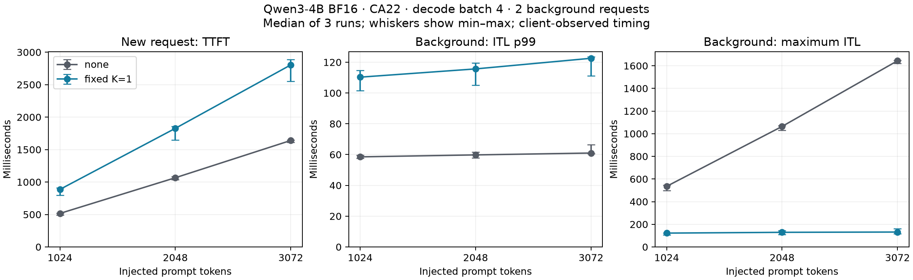

# Qwen3-4B BF16: none vs fixed K=1

실험과 검증 완료. `fixed`는 긴 decode 멈춤을 줄이는 대신 새 요청의 TTFT를 늘렸다.
ITL p99까지 모든 조건에서 개선되지는 않았다.

## 조건과 검증

- 원본 Qwen/Qwen3-4B, BF16 export, 양자화 없음. 모델 revision은 compile_manifest.json 참조.
- CA22 1장, [PR #1](https://github.com/hello-npu/vllm-rbln/pull/1) 커밋 `a84bd4cf727459db306fd3f4cb4d191dcd29054a`.
- 두 정책 모두 같은 PR 소스와 같은 컴파일 모델 사용. 기존 설치 패키지와 비교한 결과가 아님.
- decode 배치 4 고정, 최대 문맥 4096, prefill 청크 128, prefix cache 비활성화.
- greedy 생성, 출력 길이 고정. 동시 요청 1~4개와 prefill/decode 간섭을 먼저 워밍업. 워밍업 원시 기록은 공유 자료에서 제거했으며 본 측정 결과만 정책 비교에 사용했다.
- 3회 반복, seed별 정책 순서 교대. 워밍업을 제외한 18개 실행 모두 실패와 추가 컴파일 없음.
- 27개 요청 쌍, 출력 토큰 9,792개가 모두 동일. audit.json 참조.
- 초기 동시 요청에서 샘플러 추가 컴파일이 관찰된 첫 시도는 본 결과에서 제외했다. 제외된 자료와 실행 로그는 Git 공유용 폴더에 포함하지 않았다.

## 긴 프롬프트 단일 주입

128토큰 프롬프트의 배경 요청 2개가 각각 512토큰을 생성하는 동안,
시작 1초 후 긴 요청 1개를 추가해 64토큰을 생성했다.
실제 주입 시점에 두 배경 요청이 decode 중이었음을 확인했다.
다음 값은 실행별 지표의 3회 중앙값이며, 최대 ITL은 배경 요청 두 개의 전체 생성 구간에서 측정했다.

| 주입 길이 | 새 요청 TTFT: none → fixed | TTFT 증가 | 배경 최대 ITL: none → fixed | 최대 ITL 감소 |
|---|---:|---:|---:|---:|
| 1024 | 516 → 886 ms | 71.7% | 535 → 122 ms | 77.2% |
| 2048 | 1066 → 1827 ms | 71.4% | 1064 → 129 ms | 87.9% |
| 3072 | 1640 → 2804 ms | 71.0% | 1644 → 132 ms | 92.0% |

3072토큰 조건에서는 TTFT 약 1.16초를 더 쓰고, 배경 요청의 최악 간격을 약 1.51초 줄였다.
다만 배경 ITL p99는 각각 58.5→110.3, 59.8→115.7, 61.0→122.6ms로 증가했다.
none에서는 매우 긴 멈춤이 드물게 나타나 p99 밖에 위치하는 반면,
fixed에서는 prefill 중인 여러 decode 간격이 늘어나므로 최대값과 p99가 다른 방향으로 움직인다.
이는 수신 타임라인에 근거한 해석이며 NPU 커널 실행을 직접 측정한 결과는 아니다.

## Perfetto에서 보기

1. https://ui.perfetto.dev 에서 **Open trace file**을 선택한다.
2. 대표 파일 `../perfetto/injection/injection-3072-seed0.json`을 연다.
3. `none`과 `fixed` 프로세스 아래의 `bg0-0`, `bg1-0`, `long-0` 요청 트랙을 펼친다.
4. 시작 후 약 0.8~4초를 확대한다. `long-0`의 TTFT와 배경 요청의 `stream gap`을 비교한다.

두 독립 실행은 각각의 클라이언트 시작 시각에 맞춰 겹쳐 놓았다.
TTFT와 stream gap은 클라이언트가 관측한 구간이며, prefill/decode 커널 트랙이 아니다.
각 스트림 이벤트가 토큰 1개임을 검증했으므로 이번 trace에서 stream gap은 관측 ITL이다.
9개 비교 trace 모두 공식 Perfetto trace processor로 파싱했다.
파일은 외부에 업로드하지 않았다.

## 재현 및 한계

compile_model.py → run_experiment.py → report.py → plot_results.py 순서로 구성했다.
재실행 시 기존 결과 덮어쓰기를 막도록 되어 있으므로 결과 디렉터리를 먼저 별도로 보존해야 한다.
실행 환경은 environment.json, 컴파일 설정은 compile_manifest.json,
서버 명령은 metadata/server-config.json, 원시 데이터는 data/results/*/{none,fixed}/raw.json에 있다.

이번 결과는 모델 1개, 합성 반복 텍스트, 고정 decode 배치, 세 가지 주입 길이에서의 결과다.
실제 대화 품질·동적 버킷·다른 모델·포화 처리량은 평가하지 않았다.
BF16은 원본 및 export dtype을 뜻하며 NPU 내부 모든 연산의 정밀도를 보증하는 표기는 아니다.
짧은 실행의 p99.9와 최대값은 기술 통계로만 취급해야 한다.

컴파일 모델과 그래프용 가상환경은 배포 자료에서 제거했다. 재생성 및 NPU 재실행 준비는 [루트 README](../README.md)를 참조한다.
